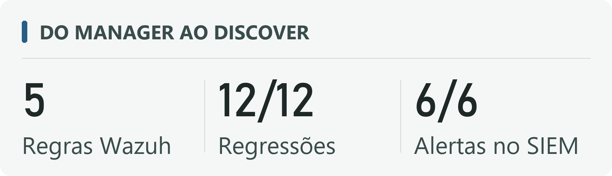

# Detection Engineering Blue Team

**Cinco regras Wazuh para Windows, da regressão local ao alerta no SIEM.**

O projeto versiona as regras em XML, documenta possíveis falsos positivos e usa dados de teste para validar o comportamento esperado. A Fase 3 acompanhou seis alertas gerados em laboratório até o Discover.

<picture>
  <source media="(prefers-color-scheme: dark)" srcset="docs/img/resumo-escuro.png">
  
</picture>

[Estudo de caso](docs/case-study-wazuh-detection-engineering.md) · [Catálogo YAML](catalog/detections.yaml) · [Arquitetura](docs/architecture.md)

## Estado da Fase 3

Os **seis alertas das cinco regras** foram conferidos no Manager, no Indexer e nos documentos JSON do Discover. A comparação usou ID original, ID da regra, agente e horário UTC. O aceite cobre os eventos da janela de 01–02/11/2026. A lacuna de indexação de 27–30/10 segue em investigação própria. [Relatório de aceite](docs/phase3-final-three-stage-six-event-acceptance-20261102.md) · [Lacuna de indexação](docs/phase3-indexing-gap-investigation.md) · [Status](STATUS.md)

## Regras de detecção

| ID | Sinal | MITRE ATT&CK |
| --- | --- | --- |
| `110100` | PowerShell com comando codificado | [T1059.001](https://attack.mitre.org/techniques/T1059/001/) |
| `110110` | Rundll32 carregando DLL de caminho gravável | [T1218.011](https://attack.mitre.org/techniques/T1218/011/) |
| `110120` | Criação de tarefa via schtasks | [T1053.005](https://attack.mitre.org/techniques/T1053/005/) |
| `110130` | Modificação de uma chave Run do Registro | [T1547.001](https://attack.mitre.org/techniques/T1547/001/) |
| `110140` | Criação de conta local com net.exe | [T1136.001](https://attack.mitre.org/techniques/T1136/001/) |

Windows Server e Sysmon geram a telemetria. O agente envia os eventos ao Wazuh Manager. A pilha em Docker processa, indexa e exibe os alertas. [Diagrama da arquitetura](assets/architecture-overview.svg) · [Critérios de aceitação](docs/detection-acceptance-criteria.md)

## Validação local

Com Python 3.11 ou superior, rode na raiz do repositório.

```powershell
python scripts/quality_gate.py
python -m unittest discover -s tests -q
```

As regressões usam fixtures positivas e benignas. O relatório de aceite cobre a verificação dos alertas no SIEM autenticado. Os arquivos brutos e os identificadores das VMs ficam na pasta privada `.lab/`. [Integração contínua](https://github.com/raphaelguterres/detection-engineering-blue-team/actions/workflows/detection-quality.yml) · [Procedimento offline da Fase 3](docs/phase3-one-command-offline.md)
