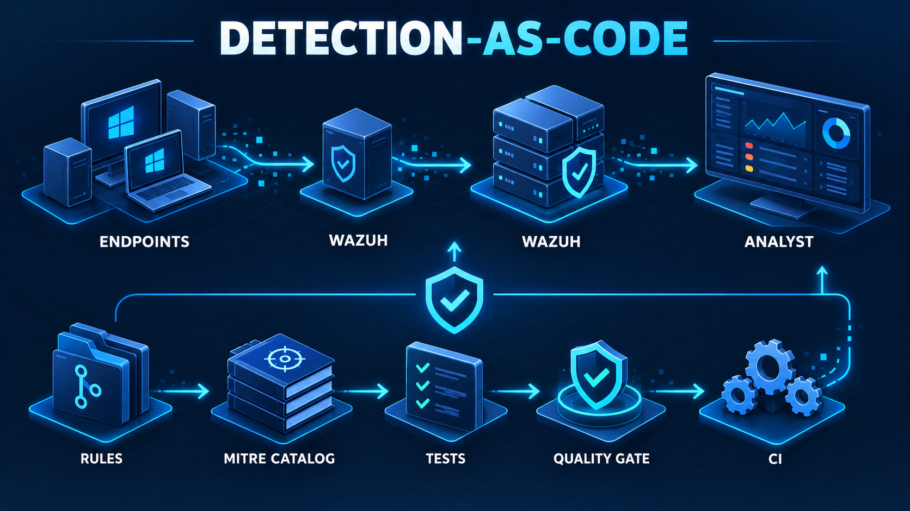

# Detection Engineering Blue Team

Repositório de **detection-as-code** focado em engenharia de detecção, separado da infraestrutura de laboratório. Cada detecção é tratada como um produto: regra versionada, cobertura MITRE ATT&CK, evidência, casos de regressão, falsos positivos conhecidos e procedimento de rollback.

> O laboratório que gera telemetria e este repositório são projetos complementares. Adicione aqui o link do projeto de lab: `TODO: link-do-lab`.



Leia a [arquitetura e o fluxo de promoção](docs/architecture.md) para entender os limites entre o laboratório, a telemetria, o Wazuh e este repositório.

## O que existe aqui

- regras locais para Wazuh;
- catálogo pesquisável por técnica MITRE;
- fixtures de eventos maliciosos e benignos;
- quality gate executável localmente e no GitHub Actions;
- simulações estritamente benignas e reproduzíveis.

## Estrutura

```text
catalog/             metadados das detecções e sua cobertura ATT&CK
rules/               regras XML prontas para importar no Wazuh
tests/fixtures/      eventos e expectativas de regressão
simulations/         procedimentos seguros que produzem a telemetria
scripts/             validações sem dependências externas
.github/workflows/   quality gate de CI
```

## Início rápido

1. Copie as regras de `rules/windows/` para o diretório de regras locais do manager Wazuh (normalmente `/var/ossec/etc/rules/`).
2. Reinicie o serviço do manager e confirme que os IDs não entram em conflito com regras existentes.
3. Execute os testes de contrato antes de promover uma alteração:

```powershell
python scripts/quality_gate.py
```

O gate valida IDs únicos, campos mínimos de qualidade, arquivos referenciados, XML bem-formado, cobertura MITRE e cenários positivos/negativos. Ele não substitui a execução das regras em um manager Wazuh real; essa validação operacional está documentada em cada simulação.

## Convenções

- IDs locais: `100100–100199`.
- Todo item do catálogo exige técnica ATT&CK, severidade, fonte de dados, evidência, owner e rollback.
- Toda regra exige ao menos um caso de detecção e um caso benigno que **não** deve alertar.
- Não inclua credenciais, malware, payloads ofensivos ou telemetria real de clientes.

## Referências

- [MITRE ATT&CK – T1059.001 PowerShell](https://attack.mitre.org/techniques/T1059/001/)
- [MITRE ATT&CK – T1053.005 Scheduled Task](https://attack.mitre.org/techniques/T1053/005/)
- [MITRE ATT&CK – T1547.001 Run Keys / Startup Folder](https://attack.mitre.org/techniques/T1547/001/)
- [MITRE ATT&CK – T1136.001 Local Account](https://attack.mitre.org/techniques/T1136/001/)
- [Wazuh – regras customizadas](https://documentation.wazuh.com/current/user-manual/ruleset/rules/custom.html)

