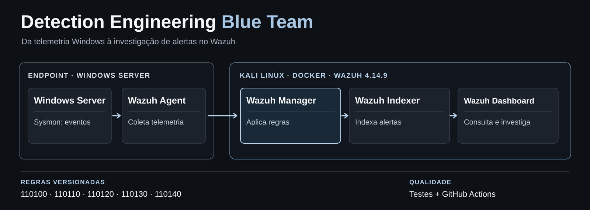

# Detection Engineering Blue Team

[](https://github.com/raphaelguterres/detection-engineering-blue-team/actions/workflows/detection-quality.yml)

**Detection-as-code com Wazuh 4.14.9:** cinco regras customizadas para Windows, testes automatizados e validação de alertas em um laboratório isolado de SOC/Blue Team.



## Como funciona

1. **Windows Server + Sysmon** geram eventos de processos e registro em cenários benignos autorizados.
2. **Wazuh Agent** coleta a telemetria do endpoint e a envia ao **Wazuh Manager**.
3. **Kali Linux + Docker** hospedam **Manager → Indexer → Dashboard**: o Manager aplica as detecções; o Indexer armazena os alertas; o Dashboard permite pesquisá-los.
4. **Este repositório** versiona regras XML, catálogo MITRE ATT&CK, testes positivos/negativos, simulações seguras e procedimentos de validação. O GitHub Actions verifica a qualidade do código — **não substitui a comprovação operacional no SIEM**.

A infraestrutura do laboratório e os registros reais permanecem separados do código público. Consulte a [arquitetura técnica](docs/architecture.md).

## Regras de detecção

| ID | O que detecta | MITRE ATT&CK |
| --- | --- | --- |
| `110100` | PowerShell com comando codificado | [T1059.001](https://attack.mitre.org/techniques/T1059/001/) |
| `110110` | Rundll32 carregando DLL de caminho gravável | [T1218.011](https://attack.mitre.org/techniques/T1218/011/) |
| `110120` | Criação de tarefa via schtasks | [T1053.005](https://attack.mitre.org/techniques/T1053/005/) |
| `110130` | Modificação de Registry Run Key | [T1547.001](https://attack.mitre.org/techniques/T1547/001/) |
| `110140` | Criação de conta local com net.exe | [T1136.001](https://attack.mitre.org/techniques/T1136/001/) |

Cada regra possui metadados, fixtures de regressão, hipótese de detecção, falsos positivos e orientações de rollback no [catálogo](catalog/detections.yaml).

## Estado da Fase 3

| Validação | Situação |
| --- | --- |
| Cinco regras versionadas e quality gate | **Concluído** |
| Regressões em árvore isolada do Wazuh 4.14.9 | **12/12 aprovadas** |
| Cinco IDs de regras observados no Indexer/Dashboard | **5/5 regras; seis alertas documentados** |
| Identidade exata Manager → Indexer (seis alertas, cinco regras) | **6/6 correlacionados — concluído** |
| Identidade exata Manager → Indexer → Dashboard Discover | **6/6 eventos / 5/5 regras — concluído** |

Uma auditoria dos arquivos rotacionados do **Manager** confirmou os seis alertas originais das cinco regras (cinco em 01/11 e um em 02/11) na janela UTC 01/11 20h–02/11 00h40. A [comparação Manager–Indexer](docs/phase3-manager-indexer-exact-correlation-20261102.md) encontrou **6/6 identidades exatas**. A [validação final independente no Dashboard Discover](docs/phase3-final-three-stage-six-event-acceptance-20261102.md) conferiu individualmente os seis documentos pela aba JSON da interface autenticada, preservando somente `id`, `rule.id`, `agent.id` e timestamp original. **Resultado operacional: 6/6 correspondências exatas nas três etapas, abrangendo as cinco regras.** O relatório CSV gerado pelo menu Reporting não incluía timestamps e **não** foi utilizado como fonte de horário; a projeção privada foi feita diretamente dos JSONs disponibilizados no Discover.

O aceite da Fase 3 está registrado na [Issue #4](https://github.com/raphaelguterres/detection-engineering-blue-team/issues/4) e no [STATUS.md](STATUS.md). A [lacuna histórica de indexação de 27–30/10](docs/phase3-indexing-gap-investigation.md) permanece uma investigação **separada**, sem causa raiz comprovada.

## Backup versionado e distribuicao do laboratorio

O GitHub e o ponto de entrada do projeto: codigo de deteccao, testes, documentacao e manifests de releases. Backups privados de VMs ficam **fora do Git**, criptografados e com snapshots incrementais no armazenamento em nuvem. Imagens publicas so serao distribuidas depois de saneamento, revisao de licencas e teste de restauracao.

- [Plano e procedimento de backup versionado](docs/versioned-cloud-backup.md)
- [Script seguro de backup Restic](scripts/cloud-backup/Backup-Lab.ps1) e [restauracao isolada](scripts/cloud-backup/Restore-Lab.ps1)

**Situacao:** preparacao concluida na branch de revisao; nenhum bucket foi provisionado e nenhum backup esta disponivel para download. As VMs atuais permanecem privadas.

## Como validar localmente (sem acessar as VMs)

Requisitos: **Python 3.11+** e PowerShell para o fluxo opcional de evidências.

```powershell
python scripts/quality_gate.py
python -m unittest discover -s tests -q
python scripts/lab/run.py plan
```

O comando `plan` não executa ações remotas. A implantação de regras e as simulações dependem de autorização e dos procedimentos descritos em [Automação do laboratório](docs/lab-automation.md) e [Purple Team seguro](docs/purple-team-safe.md).

Para reproduzir as validações, consulte o [procedimento offline da Fase 3](docs/phase3-one-command-offline.md), o [comparador Discover](docs/phase3-discover-csv-acceptance.md) e o [relatório de aceite final](docs/phase3-final-three-stage-six-event-acceptance-20261102.md). Os documentos e os registros originais permanecem privados em `.lab/` (ignorado pelo Git).

## Estrutura do repositório

```text
catalog/              Detecções e mapeamento MITRE ATT&CK
rules/windows/        Regras XML Wazuh
tests/fixtures/       Casos positivos e benignos
simulations/windows/  Cenários controlados e limpeza
scripts/              Quality gate, comparação e automação
docs/                 Arquitetura, evidências e decisões
.github/workflows/    Integração contínua
```

**Leitura técnica:** [Estudo de caso](docs/case-study-wazuh-detection-engineering.md) · [Critérios de aceitação](docs/detection-acceptance-criteria.md) · [Diário de engenharia](docs/phase3-engineering-journal.md) · [Roteiro pós-Fase 3](docs/phase3-closeout-and-next-project.md).

> **Segurança:** este repositório não contém credenciais, logs brutos, identificadores de endpoints ou dados de clientes. Sucesso no CI não deve ser apresentado como evidência de alerta real ou de resposta a incidente.
