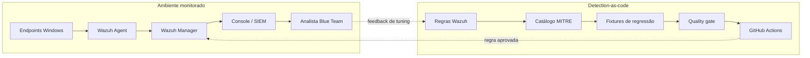

# Arquitetura

Este repositório controla o ciclo de vida das detecções; ele não hospeda o laboratório e não armazena telemetria de endpoints.

## Limites de responsabilidade

| Componente | Responsabilidade | Não pertence aqui |
| --- | --- | --- |
| Laboratório | Gera telemetria e permite validar regras operacionalmente | regras de produção e segredos do ambiente |
| Wazuh | Coleta, decodifica, correlaciona e alerta | fonte de verdade do código de detecção |
| Este repositório | Versiona regras, metadados, testes, evidência e rollback | logs de clientes ou credenciais |
| CI | Impede regressões estruturais antes do merge | validação operacional substituta |

## Fluxo de promoção

1. Uma detecção nasce no catálogo com técnica MITRE, fonte de dados, evidência, falsos positivos, tuning e rollback.
2. A regra Wazuh e uma fixture de detecção são adicionadas junto de uma fixture benigna que não deve alertar.
3. O `scripts/quality_gate.py` confere a integridade do contrato: XML, IDs, arquivos relacionados, cobertura MITRE e testes positivo/negativo.
4. A simulação benigna é executada no laboratório autorizado para confirmar a telemetria e o alerta no Wazuh.
5. Após revisão e aprovação no CI, a regra pode ser importada no Wazuh Manager por meio do processo de mudança da organização.
6. Feedback de analistas atualiza o tuning e os casos de regressão; alterações não são aplicadas diretamente no manager sem passar pelo repositório.

## Critério de pronto

Uma detecção está pronta para produção quando a regra foi validada no laboratório, o quality gate passa, os falsos positivos conhecidos estão documentados e existe um rollback executável. Isso torna uma exceção ou reversão tão reproduzível quanto a própria regra.
