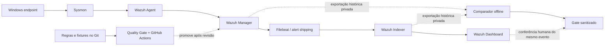

# Estudo de caso — Detection Engineering e validação Wazuh no laboratório Blue Team

> **Status em 31/10/2026: relatório técnico consolidado com resultados históricos do Manager.** A engenharia offline está aprovada; a correlação comprovada dos mesmos eventos no **Indexer e Dashboard ainda não foi executada/confirmada**. Este documento não constitui um relatório de validação operacional ponta a ponta.

## 1. Resumo executivo

O projeto `detection-engineering-blue-team` implementa **detection-as-code** para telemetria Windows/Sysmon com regras locais no Wazuh, cobertura MITRE ATT&CK, fixtures positivos e negativos, revisão de falsos positivos, GitHub Actions, executor de laboratório e classificação de evidências.

O repositório contém **cinco registros históricos de detecções operacionais no Wazuh Manager**. Duas detecções adicionais (`110130` e `110140`) foram concluídas depois de dificuldades reais com a cadeia de regras Windows e com o acesso à VM. Esses resultados foram documentados anteriormente em [operational-validation.md](operational-validation.md). Não foram reexecutados nem revalidados nesta consolidação.

Os instrumentos offline de comparação Manager ↔ Indexer, criação de rascunhos sanitizados e quality gate foram integrados por PRs sucessivos. O teste integrado no Windows concluiu com sucesso no **CI #63 usando dados sintéticos**. O CI comprova apenas o comportamento do software de teste, nunca indexação real.

**Resultado comprovado pelo material do repositório:** cinco detecções históricas documentadas no Manager. **Resultado ainda sem comprovação:** que um mesmo alerta histórico de cada regra existe no Indexer e aparece no Dashboard.

## 2. Escopo, arquitetura e limites

O repositório **não** contém os logs originais, arquivos de credenciais, hostnames internos ou identificadores do laboratório. Os arquivos privados e derivados pertencem exclusivamente à pasta local Git-ignorada `.lab/`. O desenho do Dashboard SOC está em [soc-dashboard-spec.md](soc-dashboard-spec.md), mas painéis visuais reais **não foram implantados nem validados** nesta consolidação.

### Níveis de prova

| Nível | O que demonstra | Situação |
| --- | --- | --- |
| Contrato e CI | XML, metadados, fixtures, proteções e comportamento offline | Evidência de engenharia registrada |
| Alerta histórico no Manager | Sysmon → Agent → Manager e regra correspondente, nos cenários documentados | **5/5 históricos documentados** |
| Mesmo documento no Indexer | Ingestão e indexação do evento histórico específico | **Não comprovado** |
| Mesmo documento no Dashboard | Visibilidade e correlação de ID, agente, regra e horário | **Não comprovado** |
| Pipeline remoto autenticado integral | Orquestração real de todo o fluxo de laboratório | **Não comprovado** |

Não se deve classificar **5/5 detecções no Manager** como **5/5 indexadas ou validadas ponta a ponta**.

## 3. Matriz de detecções e resultados históricos

| Caso | Regra | MITRE ATT&CK | Telemetria | Evidência histórica documentada | Indexer / Dashboard |
| --- | --- | --- | --- | --- | --- |
| PowerShell `-EncodedCommand` | `110100` | `T1059.001` | Sysmon Event ID 1 | Alerta no Manager após comando benigno que imprime marcador | Não verificados |
| Rundll32 em caminho gravável | `110110` | `T1218.011` | Sysmon Event ID 1 | Regra alertou sem carregar DLL (referência a arquivo inexistente) | Não verificados |
| Criação de tarefa descartável | `110120` | `T1053.005` | Sysmon Event ID 1 | Alerta de `schtasks`; tarefa não executada e removida | Não verificados |
| Valor temporário em Run Key | `110130` | `T1547.001` | Sysmon Event ID 13 | Alerta **nível 12** após ajuste da cadeia de regras Windows; valor removido | Não verificados |
| Tentativa benigna de conta local | `110140` | `T1136.001` | Sysmon Event ID 1 | **Dois alertas nível 12**, conta temporária removida; detecta a tentativa, não sucesso na criação | Não verificados |

**Classificação desta matriz:** `manager_documented_historical` para as cinco regras; `indexer_not_confirmed`, `dashboard_not_confirmed` e `end_to_end_not_proven` para todas. Estes marcadores descrevem o estado da documentação, **não** são saídas do validador de evidências nem novas medições.

## 4. Investigação técnica: hipóteses, falhas e correções

### 4.1 — Decodificação e correlação de eventos Windows

A regra `110130` para Run Keys inicialmente não gerou o resultado esperado no fluxo ao vivo. Uma reprodução isolada de `full_log` utilizava o decoder `json`, enquanto o evento real chegava por `windows_eventchannel`. A árvore de regras Windows finalizava em `92300` com nível zero; os vínculos da regra local precisaram levar isso em consideração, além de ajustes no padrão de separadores.

Depois da correção e de uma nova execução autorizada **anteriormente documentada**, o Sysmon Event ID 13 produziu o alerta `110130` **nível 12** no Manager. O valor Run Key de teste foi removido, e `logall_json` foi restaurado a `no`.

**Aprendizado:** passar uma fixture ou replay com decoder diferente não garante correspondência com a cadeia de regras e a telemetria real do Windows.

### 4.2 — Tentativa de criação de conta

A regra `110140` depende de telemetria de criação de processo, não de confirmação de cadastro de conta. Na validação histórica final, a tentativa benigna de criação duplicada com `net user` gerou eventos Sysmon e **dois alertas nível 12** no Manager. A conta temporária desabilitada foi removida.

**Limitação:** o alerta comprova a **tentativa de execução pelo comando**, não a criação bem-sucedida de uma identidade local.

### 4.3 — Acesso à infraestrutura e ambiente

O histórico [operational-validation.md](operational-validation.md) registra obstáculos durante a retomada das VMs: agente inicialmente sem conexão, diferenças entre autenticação no desktop e WinRM, host SSH não reconhecido e ausência de acesso autorizado em determinados momentos. As linhas mais antigas que mencionam **3/5** representam estados **cronológicos anteriores** às confirmações finais de `110130` e `110140`; o cabeçalho e as evidências finais do próprio documento registram **5/5 no Manager**.

**Aprendizado:** problemas de conectividade, autenticação e cobertura de telemetria precisam ser distinguidos de falhas da lógica de detecção.

## 5. Qualidade e reprodutibilidade

A disciplina de engenharia inclui critérios de aprovação por regra, fixtures positivas/benignas, revisão de severidade e qualidade de telemetria, procedimentos de limpeza e rollback, além de CI e revisão técnica antes da integração à `main`.

**Histórico de integrações conferidas:**

| PR | Entrega | Commit de merge |
| --- | --- | --- |
| [#1](https://github.com/raphaelguterres/detection-engineering-blue-team/pull/1) | Hardening de executor e critérios | `4db9f19` |
| [#2](https://github.com/raphaelguterres/detection-engineering-blue-team/pull/2) | Contrato da prova Manager/Indexer/Dashboard | `e4cdbc7` |
| [#3](https://github.com/raphaelguterres/detection-engineering-blue-team/pull/3) | Comparação histórica de identidade | `a9e41b2` |
| [#5](https://github.com/raphaelguterres/detection-engineering-blue-team/pull/5) | Rascunho de evidências conservador | `1b30477` |
| [#6](https://github.com/raphaelguterres/detection-engineering-blue-team/pull/6) | Execução offline em um comando | `77bbe01` |
| [#7](https://github.com/raphaelguterres/detection-engineering-blue-team/pull/7) | Status e encerramento condicional | `8e871b1` |

Em especial, o [CI #63](https://github.com/raphaelguterres/detection-engineering-blue-team/actions/runs/41228763576) registrou sucesso dos testes de contratos e do fluxo offline Windows com eventos **sintéticos**, incluindo proteção contra junctions. O [CI #65](https://github.com/raphaelguterres/detection-engineering-blue-team/actions/runs/41229243101) aprovou o PR de documentação. Nenhum deles é uma medição de latência de detecção, retenção ou entrega de eventos no Indexer.

## 6. Verificação operacional final — **pendente de dados reais**

Antes de declarar a integração operacional validada, um operador autorizado precisa:

1. Selecionar a janela UTC real dos alertas históricos, verificando rotação e retenção dos índices.
2. Confirmar, com permissões somente leitura, os mesmos registros em `/var/ossec/logs/alerts/alerts.json` (ou arquivos históricos correspondentes) e no índice `wazuh-alerts-*`.
3. Produzir duas exportações independentes privadas em `.lab/`; cópias do mesmo arquivo não contam como duas fontes.
4. Executar localmente o [runner offline](phase3-one-command-offline.md) e preservar os resultados com identificador único por execução.
5. Conferir **cada alerta selecionado no Dashboard**, com mesmo ID de evento, regra, agente e horário UTC, observando o data view e possíveis diferenças de mapeamento.
6. Preencher o [modelo sanitizado](phase3-evidence-template.md) e classificar **cada regra** com o gate. Um evento ausente por retenção é **inconclusivo**, não prova falha de ingestão.
7. Publicar **somente** a decisão sanitizada, escopo, método e limites; não publicar IDs, logs brutos, credenciais, screenshots não tratados ou dados do endpoint.

**Referência central:** [Issue #4 — evidência operacional pendente](https://github.com/raphaelguterres/detection-engineering-blue-team/issues/4).

### Matriz de aceitação atual (nenhuma conclusão inventada)

| Regra | Manager — registro histórico | Indexer — mesma identidade | Dashboard — mesma identidade | Estado ponta a ponta |
| --- | --- | --- | --- | --- |
| `110100` | Documentado | Não examinado nesta consolidação | Não examinado nesta consolidação | **Não verificado** |
| `110110` | Documentado | Não examinado nesta consolidação | Não examinado nesta consolidação | **Não verificado** |
| `110120` | Documentado | Não examinado nesta consolidação | Não examinado nesta consolidação | **Não verificado** |
| `110130` | Documentado | Não examinado nesta consolidação | Não examinado nesta consolidação | **Não verificado** |
| `110140` | Documentado | Não examinado nesta consolidação | Não examinado nesta consolidação | **Não verificado** |

**Critério para “1 detecção end-to-end validada”:** o mesmo alerta identificado no Manager, Indexer e Dashboard, com evidência independente das três observações. Para declarar **5/5**, aplicar esse critério separadamente a todas as cinco regras.

## 7. Falsos positivos, métricas e riscos residuais

- **PowerShell:** automações administrativas e instalações legítimas também podem usar comandos codificados. Revisar contexto da linha de comando e exceções.
- **Rundll32:** instaladores legítimos podem iniciar binários do sistema a partir de diretórios temporários ou graváveis.
- **Scheduled Tasks:** rotinas de manutenção podem gerar `schtasks` sem intenção adversária.
- **Run Keys:** configurações autorizadas de inicialização automática podem ser benignas.
- **Local account attempt:** provisionamento administrativo pode usar `net user`; a detecção não comprova criação consumada.

**Métricas não apuradas:** taxa de falsos positivos real, TTD/MTTD, TTR/MTTR, porcentagem de ingestão no Indexer, tempo de indexação, disponibilidade do Dashboard e cobertura de todas as variações ATT&CK. Não apresentar métricas simuladas como resultados operacionais.

**Riscos residuais:** dependência de retenção histórica; acessos indisponíveis no momento da consolidação; diferenças de timestamp/mapeamento; provenance das exportações; ausência de correlação documental no Dashboard.

## 8. Conclusão publicável e condição de encerramento

> Foram desenvolvidas e versionadas cinco detecções de segurança Windows com Sysmon e Wazuh, cobrindo PowerShell, Rundll32, tarefas agendadas, persistência por Run Key e tentativa de criação de conta. O projeto inclui registros históricos de alertas no Wazuh Manager, testes positivos e benignos, CI, revisão de regras e um fluxo offline para correlação e documentação de evidências. A confirmação da mesma identidade do alerta no Indexer e Dashboard permanece pendente, portanto o SIEM ainda não é apresentado como validado ponta a ponta.

**Critério de encerramento:** somente atualizar a conclusão acima, marcar a Issue #4 como resolvida ou divulgar “end-to-end validado” **após** a verificação operacional real e revisão do material sanitizado. O relatório não deve ser alterado para criar evidência retrospectiva inexistente.

### Fontes internas de rastreabilidade

- [Registro histórico das cinco detecções](operational-validation.md)
- [Critérios objetivos por regra](detection-acceptance-criteria.md)
- [Procedimento de inspeção somente leitura](wazuh-indexer-dashboard-validation.md)
- [Runner local e limitações](phase3-one-command-offline.md)
- [Especificação, ainda não implementada, do Dashboard SOC](soc-dashboard-spec.md)
- [Status do repositório](../STATUS.md)
